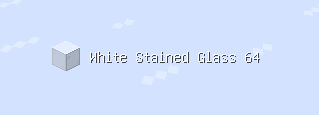

# AntiDeath Survival Assistant

客户端 Fabric 模组，为 [masa 系模组](https://masa.dy.fi/) 补充生存辅助、界面调整与性能优化。默认按 `Z,K` 打开设置，配置保存在 `config/asa.json`。

***感谢 [@OptiJava](https://github.com/OptiJava) 的指导。***

## 前置模组

| 名称 | 类型 | 链接 |
| --- | --- | --- |
| malilib | 必需 | [Sakura 1.21+](https://github.com/sakura-ryoko/malilib) / [Masa 1.21-](https://masa.dy.fi/tmp/minecraft/mods/malilib/) |
| Fabric API | 必需 | [官方](https://fabricmc.net/) / [MC百科](https://www.mcmod.cn/class/3124.html) |

## 支持版本

| Minecraft | 状态 |
| --- | --- |
| 1.21.x | 持续更新 |
| 26.1.x – 26.3 | 持续更新 |

> Fabric Loader ≥ 0.16；1.21.x 使用 Java 21，26.x 使用 Java 25。

## 功能

> 所有配置同时出现在「全部」页签，以下按所属分类列出。`未绑定` 表示快捷键默认没有按键。

### 功能（FUNCTIONS）

| 功能 | 说明 | 类型 | 默认值 |
| --- | --- | --- | --- |
| 打开设置菜单 | 打开 ASA 配置界面 | 快捷键 | `Z,K` |
| 剩余物品显示Overlay | 显示主手物品、名称与剩余数量（含潜影盒） | 布尔值  | `false` |
| 剩余物品显示Overlay-X偏移 | 水平偏移（像素） | 整数 | `0` |
| 剩余物品显示Overlay-Y偏移 | 垂直偏移（像素） | 整数 | `0` |
| 苦力怕预警器 | 附近有苦力怕时在动作栏提示并播放音效 | 布尔值  | `true` |
| 苦力怕预警器范围 | 检测半径，0–64 | 浮点 | `8.0` |
| 低生命值自动执行命令/发送聊天消息 | 生命值低于阈值时自动发送消息或执行命令 | 布尔值  | `false` |
| 生命值阈值 | 触发阈值，1–20 | 浮点 | `4.0` |
| 发送模式 | 发送聊天消息 / 发送命令 / 自动 | 选项 | `自动` |
| 发送内容-消息 | 低生命值时发送的聊天内容 | 字符串 | `!s` |
| 发送内容-指令 | 低生命值时执行的命令（无需 `/`） | 字符串 | `spectator` |
| 随时可以断开连接 | 在服务器重配置界面保持断开按钮可用 | 布尔值  | `false` |
| 可在游戏中打开多人游戏菜单 | 暂停菜单增加多人游戏按钮 | 布尔值  | `false` |
| TAB菜单过滤器 | 过滤 TAB 列表中的无用玩家或假人 | 布尔值  | `false` |
| 启用TAB菜单过滤器-白名单 | 只显示白名单中的玩家 | 布尔值 | `false` |
| 启用TAB菜单过滤器-前缀 | 隐藏名称以指定前缀开头的玩家 | 布尔值 | `false` |
| 触发假人杀戮光环 | 对附近延迟为 0 的假人执行 kill | 快捷键 | `未绑定` |
| 假人杀戮光环范围 | 检测半径，0–32 | 浮点 | `4.0` |
| 启用假人杀戮光环黑名单 | 黑名单中的假人不会被处理 | 布尔值  | `false` |
| 启用假人杀戮光环白名单 | 只处理白名单中的假人 | 布尔值  | `false` |
| 旁观假人TP菜单 | 旁观传送菜单中单独列出假人 | 布尔值  | `false` |
| 强制方块挖掘冷却 | 强制遵循原版挖掘冷却 | 布尔值  | `false` |
| 平坦挖掘 | 不潜行时禁止破坏脚下方块 | 布尔值 | `false` |
| 右键告示牌执行命令 | 潜行右键告示牌执行以 `/` 开头的行 | 布尔值  | `false` |
| 强制使用烟花火箭 | 右键时优先使用手持烟花火箭 | 布尔值  | `false` |
| 启用自动垃圾清理 | 打开容器时自动清理垃圾物品 | 布尔值  | `false` |
| 启用自动垃圾清理-切换模式 | 在两种清理模式间切换 | 快捷键 | `未绑定` |
| 启用自动垃圾清理-清理模式 | 丢出物品 / 转移至容器 | 选项 | `丢出物品` |
| 启用自动垃圾清理-保存背包物品 | 将背包物品保存到已启用的名单 | 快捷键 | `未绑定` |
| 启用自动垃圾清理白名单 | 只清理白名单中的物品 | 布尔值  | `false` |
| 启用自动垃圾清理黑名单 | 清理黑名单以外的物品 | 布尔值  | `false` |
| 触发-潜影盒物品分离器 | 打开背包中的潜影盒并丢出指定物品 | 快捷键 | `未绑定` |
| 启用自定义方块碰撞箱 | 将指定方块的碰撞箱改为完整方块 | 布尔值  | `false` |
| 启用自定义方块碰撞箱白名单 | 只对白名单中的方块生效 | 布尔值  | `false` |
| 启用自定义方块碰撞箱黑名单 | 黑名单中的方块保持原版 | 布尔值  | `false` |
| 启用自定义方块交互碰撞箱 | 将指定方块的交互形状改为完整方块 | 布尔值  | `false` |
| 启用自定义方块交互碰撞箱-白名单 | 只对白名单中的方块生效 | 布尔值  | `false` |
| 启用自定义方块交互碰撞箱-黑名单 | 黑名单中的方块保持原版 | 布尔值  | `false` |
| 启用自定义投影方块替换 | 放置投影时把方块替换为指定方块 | 布尔值  | `false` |
| 启用自动盒子补货 | 从潜影盒补充手上的物品 | 布尔值  | `false` |
| 启用自动盒子补货-白名单 | 只对白名单中的物品补货 | 布尔值  | `false` |
| 启用自动盒子补货-黑名单 | 黑名单中的物品不补货 | 布尔值  | `false` |
| 挂载Logger信息到MiniHUD | 把 TAB 中的 Logger 行追加到 MiniHUD | 布尔值  | `false` |
| 启用挂载Logger信息到MiniHUD-白名单 | 只显示包含关键字的行 | 布尔值  | `false` |
| 启用挂载Logger信息到MiniHUD-黑名单 | 隐藏包含关键字的行 | 布尔值  | `false` |

剩余物品 Overlay： 

### 禁用（DISABLES）

| 功能 | 说明 | 类型 | 默认值 |
| --- | --- | --- | --- |
| 打开材料列表时禁用字幕 | 显示投影材料列表时隐藏字幕 | 布尔值  | `false` |
| 禁用玩家盔甲渲染 | 只隐藏玩家盔甲，其他实体不受影响 | 布尔值  | `false` |
| 禁用TAB菜单背景 | 隐藏 TAB 列表背景 | 布尔值  | `false` |
| 禁用容器背景渲染 | 隐藏容器界面背景 | 布尔值  | `false` |
| 禁用计分板背景 | 隐藏侧边栏背景 | 布尔值  | `false` |
| 禁用字幕背景 | 只显示字幕文本 | 布尔值  | `false` |
| 禁用掉落物旋转 | 掉落物不再旋转 | 布尔值  | `false` |
| 禁用连接超时 | 拦截超时异常，避免加载大投影被踢 | 布尔值  | `false` |
| 禁用加载地形屏幕 | 隐藏进入世界时的加载界面 | 布尔值  | `false` |
| 禁用数据包踢出 | 跳过无法解析的数据包 | 布尔值  | `false` |
| 禁用数据包踢出-强制进入服务器 | 忽略未注册数据包强行进入服务器 | 布尔值  | `false` |
| 禁用网络协议错误 | 阻止协议错误导致踢出 | 布尔值  | `false` |
| 禁用Profiler | 禁用客户端性能分析 | 布尔值  | `false` |
| 禁用确认执行屏幕(1.21.10+) | 自动确认命令执行界面 | 布尔值  | `false` |
| 禁用客户端光照更新(26.1+) | 跳过客户端光照更新 | 布尔值  | `false` |

### 优化（OPTIMIZATIONS）

| 功能 | 说明 | 类型 | 默认值 |
| --- | --- | --- | --- |
| 展示框优化 | 优化展示框与地图画的渲染和数据存储 | 布尔值  | `false` |
| 展示框优化-展示框边框可见性(26.1+) | 永远可见 / 无物品时可见 / 永不可见 | 选项 | `无物品时可见(平衡)` |
| 告示牌文本优化 | 缓存文本状态，提升渲染性能 | 布尔值  | `false` |
| 朝向检测优化 | 加速方块朝向名称查找 | 布尔值  | `false` |
| MiniHUD掉帧优化 | 异步更新 MiniHUD 的 HUD 行 | 布尔值  | `false` |
| 计分板优化 | 缓存计分板分数列表 | 布尔值  | `false` |
| 实体光照优化 | 使用固定实体光照值 | 布尔值  | `false` |
| 快速模型渲染(26.2+) | 合并相同渲染类型的几何体 | 布尔值  | `false` |
| 多线程投影加载 | 异步加载投影，减少卡顿 | 布尔值  | `false` |
| 多线程投影加载线程数 | 1 – 逻辑处理器数量 | 整数 | `2` |

### 命令（COMMANDS）

| 功能 | 说明 | 类型 | 默认值 |
| --- | --- | --- | --- |
| /pm 命令 | 批量操作假人 | 布尔值  | `false` |
| /pm 命令执行冷却 | 每个 Action 之间的等待时间，1–1000 毫秒 | 整数 | `10` |
| /pm 命令默认前缀 | 省略前缀时使用的假人名称前缀 | 字符串 | `bot_` |
| 自动宝库命令 /autovault | 自动生成假人并循环开启宝库 | 布尔值  | `false` |

### 列表（LISTS）

| 功能 | 说明 | 类型 | 默认值 |
| --- | --- | --- | --- |
| TAB菜单过滤器-白名单 | 玩家名，每行一个 | 字符串列表 | 空 |
| TAB菜单过滤器-黑名单 | 玩家名，每行一个 | 字符串列表 | 空 |
| TAB菜单过滤器-前缀 | 名称前缀，每行一个 | 字符串列表 | 空 |
| 假人杀戮光环黑名单 | 玩家名，每行一个 | 字符串列表 | 空 |
| 假人杀戮光环白名单 | 玩家名，每行一个 | 字符串列表 | 空 |
| 自动垃圾清理-白名单 | 物品 ID，每行一个 | 字符串列表 | 空 |
| 自动垃圾清理-黑名单 | 物品 ID，每行一个 | 字符串列表 | 空 |
| 挂载Logger信息到MiniHUD-白名单 | 关键字，每行一个 | 字符串列表 | 空 |
| 挂载Logger信息到MiniHUD-黑名单 | 关键字，每行一个 | 字符串列表 | 空 |
| 自定义方块碰撞箱-白名单 | 方块 ID，每行一个 | 字符串列表 | 空 |
| 自定义方块碰撞箱-黑名单 | 方块 ID，每行一个 | 字符串列表 | 空 |
| 自定义方块交互碰撞箱-白名单 | 方块 ID，每行一个 | 字符串列表 | 空 |
| 自定义方块交互碰撞箱-黑名单 | 方块 ID，每行一个 | 字符串列表 | 空 |
| 自定义投影方块替换列表 | `原始ID → 替换ID`，每行一条 | 字符串列表 | 空 |
| 自动盒子补货-白名单 | 物品 ID，每行一个 | 字符串列表 | 空 |
| 自动盒子补货-黑名单 | 物品 ID，每行一个 | 字符串列表 | 空 |
| 假人背包物品缓存-假人白名单 | 假人名称或前缀，每行一个 | 字符串列表 | 空 |

### LMS 假人取货（LMS）

| 功能 | 说明 | 类型 | 默认值 |
| --- | --- | --- | --- |
| 打开假人取货菜单 | 浏览缓存的假人库存并发起取货 | 快捷键 | `未绑定` |
| 假人远程取货支持 | 假人远程取货主开关 | 布尔值 | `false` |
| 假人取货自动查询 | 定时刷新库存数据 | 布尔值 | `false` |
| 中键投影取货 | 中键点击投影方块时请求物品 | 布尔值  | `false` |
| 假人取货自动打开假人背包 | 取货后自动打开假人背包 | 布尔值  | `false` |
| 自动打开假人背包交互模式 | 指令交互 / 右键交互 | 选项 | `右键交互` |
| 假人远程取货自动下线假人 | 关闭背包后让假人下线 | 布尔值  | `false` |
| 假人远程取货自动打开背包/自动下线延迟 | 等待时间，100–1000 毫秒 | 整数 | `100` |
| 假人背包物品缓存 | 缓存假人背包并优先从缓存取货 | 布尔值  | `false` |
| 假人背包物品缓存-清理缓存 | 清空已缓存的假人背包 | 快捷键 | `未绑定` |
| 投影材料列表-统计全物品 | 材料列表计入服务端库存 | 布尔值  | `false` |
| 投影材料列表-统计假人背包 | 材料列表计入缓存的假人背包 | 布尔值  | `false` |

> 另有 `debug`、`触发调试` 两项调试配置，仅在「全部」页签显示。

## Star History

